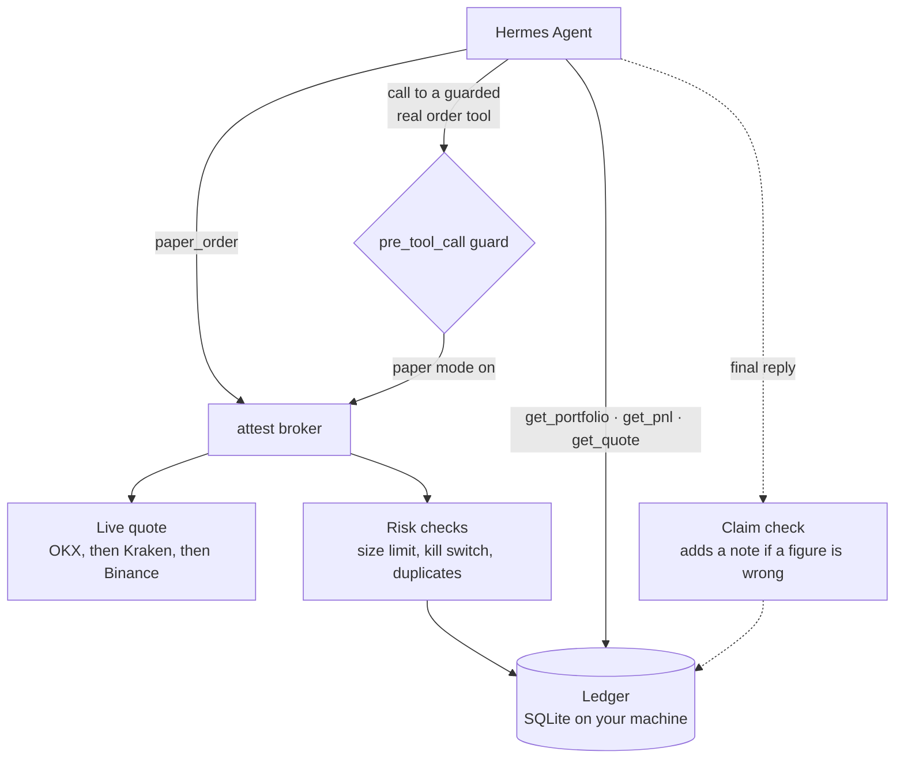

# attest

**Your agent can trade. It can't make up the numbers.**

Ask an AI agent how your portfolio is doing and it will tell you. Confidently, with decimals. Sometimes the number is right. Sometimes it's a figure the model put together from three messages ago, a price it half remembers, and some arithmetic it never actually did.

For chat, that's annoying. For money, it's the whole problem.

attest gives a Hermes agent a paper trading account where the plugin owns the money and the agent doesn't. Every order is priced from a live exchange quote, checked against your risk limits, and written to a ledger on your machine. The agent's tools tell it to ask that ledger for your balance, positions and profit, and the ledger is the only place those numbers exist. And if it states a figure in its reply that the ledger disagrees with, attest adds a line under the reply with the real one.

The idea in one line: the agent makes the decisions, attest keeps the books.

> **Know the boundary.** attest is paper trading only. No real money moves, no exchange account is involved, and no API keys are needed. Prices come from public exchange tickers. It can stand in front of one real order tool you name and simulate its orders instead, but it does not place real trades for you.

[See it work](#see-it-work) · [Why it matters](#why-it-matters) · [How it works](#how-it-works) · [How it differs](#how-it-differs) · [Tools and commands](#tools-and-commands) · [Install](#install) · [Configuration](#configuration) · [Limitations](#limitations) · [Security disclosure](#security-disclosure) · [Test it](#test-it)

## See it work

You need Hermes Agent 0.23.0 or later, with attest installed and enabled. Your paper account starts with 10,000 USDT.

### 1. Look at the account

```text
/attest status
```

```text
attest paper account (source: attest ledger, as of 2026-11-09T14:26:37Z)
  cash:           9,308.29 USDT
  positions:
    BTCUSDT: 0.01036370 @ avg 68,816.33, mark 74,629.30 (live bid), value 773.44, unrealized 60.24
  total equity:   10,081.72 USDT (started with 10,000.00)
  realized P&L:   21.48 USDT
  unrealized P&L: 60.24 USDT
  total P&L:      81.72 USDT (0.82%)
  fees paid:      0.70 USDT
  trades:         6 (3 buys, 3 sells)
  limits:         max order 1,000.00 USDT, max daily loss 500.00 USDT
  today (2026-11-09): no order yet today, so no starting equity recorded
  kill switch:    off
  paper mode:     on; no external order tool guarded (attest's own tools only)
  marks: live bid
  (display rounded: USDT to 2 decimals, quantities to 8; the ledger keeps full precision)
```

### 2. Trade in plain words

> Buy $500 of BTC.

attest fetches a live quote, turns $500 into a quantity at the ask, adds slippage and a fee, and records the fill along with the exact quote that priced it: bid, ask, which exchange, and when. The agent never has to know or guess the price of BTC.

> Buy $5000 of BTC.

Rejected. It's over the 1,000 USDT per order limit, and the reason says so with both numbers. Nothing goes on the ledger.

### 3. Ask how you're doing

> How am I doing?

The agent calls `get_pnl` and reads the answer off the ledger: realized, unrealized, total, return, fees. Every figure in that answer has a source.

### 4. Catch a wrong number

If the agent states a balance or P&L figure that doesn't match the ledger, attest leaves its reply alone and adds one line underneath:

```text
attest check: the ledger shows equity 10,081.72 USDT, not 10,580 USDT.
```

### 5. Check it is really working

```text
/attest check
```

This runs 35 checks against a temporary database with fake price sources: the arithmetic, restarts, the main rejections (oversell, overspend, stale and missing quotes, oversize orders, duplicates), the kill switch, the price fallback, the guard and the claim check. It prints PASS only for a check that actually ran and passed. Your real ledger isn't touched and nothing goes over the network.

## Why it matters

People are already handing agents their trading. Small accounts, crypto, a few stocks, a strategy someone wants to test before putting real money behind it. The agent part is getting good. The bookkeeping part is still a language model doing sums in its head.

That breaks in quiet ways. The agent quotes a price from memory. It forgets a fee. It counts a sell twice because the tool call got retried. It says you're up 4% when you're down. Nothing crashes, so you don't notice until the numbers you trusted turn out to be invented.

Paper trading is supposed to be the safe place to learn whether a strategy works. That only means something if the paper account is honest. attest makes the account the one part of the loop the model can't improvise.

## How it works



### The ledger is the source of truth

Cash, positions, every fill, realized P&L, the kill switch state and each day's starting equity live in a SQLite file in the plugin's data folder. Amounts are stored as exact decimals, not floating point, and each order is one locked transaction: either the whole fill is written, or nothing is. It survives restarts.

The agent reads from it through `get_portfolio` and `get_pnl`. Both tools tell the model, in their own descriptions, that they are the only source of truth for the account and must be called instead of estimating. They're also written in the words people actually use (balance, holdings, profit, how am I doing) because Hermes finds tools by searching, and a reporting tool the model can't find is a reporting tool it won't call.

### Prices come from a live quote or not at all

Every fill is priced from the live order book: buys at the ask, sells at the bid, with slippage against you. attest asks OKX first, then Kraken, then Binance, and moves to the next one if a source fails, times out, or sends a crossed or broken quote. Each source gets 3 seconds, DNS lookup included.

A quote older than 10 seconds is never used. OKX quotes carry the exchange's own timestamp, so staleness is measured from when the exchange produced the price, not when it arrived. If no source can give a fresh quote, the order is rejected. attest never fills at a stale, guessed or last traded price. A quote can be reused for up to 2 seconds to save a request, always inside that 10 second limit.

### Fills that behave like a real exchange

Market orders fill immediately at the top of the book plus slippage. Limit orders fill only if they're marketable right now, and never at a worse price than your limit. A limit that isn't marketable is rejected, because attest doesn't hold resting orders. A dollar order ("$500 of BTC") is turned into a quantity from the live price, rounded down to 8 decimals. Fees come out of the trade the way they would on an exchange: buy fees go into your cost basis, sell fees come out of realized P&L.

### Risk limits, checked before the fill

- **Order size.** Any order bigger than `max_order_notional` (1,000 USDT by default) is rejected before it fills.
- **Daily loss kill switch.** At the first order of each UTC day, attest records your starting equity. If equity at live prices falls by `max_daily_loss` (500 USDT by default) or more, the switch trips and stays tripped across restarts. While it's tripped, any order that adds risk is rejected. Sells that only reduce a position still go through, so you're never trapped.
- **Only a human can turn it back on.** `/attest resume` is a slash command, not a tool, so the agent has no way to clear it. It also clears at the next UTC day.
- **Can't check the risk, can't buy.** If some position has no live price, the daily loss can't be measured, so new buys are refused until it can.

The kill switch state is checked before any network call. A tripped account refuses a buy before it even asks for a quote.

### No double trades

Agents retry. A retried order shouldn't become two orders. If the agent sends the same `client_order_id` again, attest returns the original fill and records no new trade. And an identical order in the same session within 10 seconds, without a new id, is rejected as a possible duplicate, with a reason that tells the model how to send a second order if it really meant one.

### Guard a real order tool

If your Hermes setup has a real broker tool, you can name it in `intercept_tool`. While `paper_mode` is on, attest stops every call to that tool before it runs, sends the order through the same broker, risk checks and ledger as `paper_order`, and hands the agent the result, labeled "attest paper mode: this order was simulated, nothing was sent to <tool>". The real tool never executes.

This guard fails closed. If attest can't map the arguments, or hits any internal error while handling that one tool, the call is blocked with the reason. A bug in a paper trading plugin should never be the reason a real order goes out. Every other tool is left alone instantly.

With `paper_mode` off, the guarded tool runs for real, and attest goes back to watching only its own tools.

### The claim check

The ledger is the guarantee. The claim check is the visible backup.

At the end of each turn, attest reads the agent's reply for figures it can tie to exactly one ledger field: a number with $, USDT or % near words like balance, cash, equity, P&L, profit, loss or return. It compares each one to the ledger at full precision. A money figure that's off by more than 1 USDT or 0.5% (whichever is larger), or a return that's off by more than 0.05 percentage points, gets one line appended with the real value. A figure called "balance" is flagged only if it matches neither your cash nor your equity. It never rewrites or deletes anything the agent said.

It's deliberately cautious. It skips hypotheticals, prices, fees, limits and today's figures, ignores any number it can't ground, runs only in sessions that have used attest, and checks equity, unrealized P&L, total P&L and return only while prices are live. If it ever hits an error, the reply goes out unchanged.

## How it differs

None of the pieces here are new on their own. Paper trading exists. Kill switches exist. Checking a model's claims exists.

What attest does is put them in one place, in the order that matters for an agent. The money lives in a ledger the model can't write to. The model is told to ask that ledger for every number, and when it talks money without asking, the claim check is there. Orders go through risk checks before they touch it. A real order tool can be put behind it. And when the model talks about money anyway, its claims get checked against the books.

A prompt or skill that asks the model to keep track of a paper account still leaves the model holding the numbers. attest takes them away from it.

## Tools and commands

**Tools the agent gets**

| Tool | What it does |
| --- | --- |
| `paper_order` | Places a simulated order: symbol, side, and either a quantity or a dollar amount (`notional`), optional limit price, note and `client_order_id`. Priced from a live quote, after the risk checks. |
| `get_quote` | The live bid and ask for a symbol, with the exchange, quote time and age. Or an error with no price, never a guess. |
| `get_portfolio` | Cash, positions marked at the live bid, total equity, the risk limits and the kill switch state. |
| `get_pnl` | Realized, unrealized and total P&L, return %, fees, trade counts, and today's P&L against the loss limit. |

Symbols like `BTC`, `btc/usdt` and `BTCUSD` all become `BTCUSDT`. Only USDT pairs are accepted, because the account is in USDT.

**Commands, for you only**

| Command | What it does |
| --- | --- |
| `/attest status` | The readable account view shown above. |
| `/attest check` | The 35 check self test. Temporary database, fake prices, no network. |
| `/attest resume` | Clears a tripped kill switch. Today's loss count restarts from the next order. |
| `/attest reset [amount]` | Wipes trades, positions and risk state and starts a fresh account with your `starting_balance` (10,000 USDT by default), or with the amount you give. |

## Install

Requirements: Hermes Agent 0.23.0 or later. attest uses only the Python standard library.

```bash
hermes plugins install pgreyy/attest
hermes plugins enable attest
hermes gateway restart
```

Then, in a Hermes chat:

```text
/attest status
```

## Configuration

Settings live under `plugins.entries.attest.settings`. Open the config with `hermes config edit`, or set one value at a time with `hermes config set`.

| Setting | Default | What it does |
| --- | --- | --- |
| `starting_balance` | `10000` | USDT for a new account, and the default for `/attest reset`. Changing it never touches an existing account. |
| `fee_bps` | `10` | Fee per fill, in basis points (0.1%). |
| `slippage_bps` | `5` | Slippage against you, in basis points. Never pushes a fill past your limit. |
| `max_quote_age_seconds` | `10` | Older quotes are never used to fill or to mark positions. |
| `max_order_notional` | `1000` | The largest order allowed, in USDT. |
| `max_daily_loss` | `500` | The daily loss, in USDT, that trips the kill switch. |
| `dedupe_window_seconds` | `10` | How long an identical repeat counts as a possible duplicate. `0` turns it off. |
| `paper_mode` | `true` | On: calls to `intercept_tool` are simulated. Off: they run for real. |
| `intercept_tool` | `""` | The one real order tool to guard. Empty means none. |
| `intercept_args` | `{}` | Maps attest's field names to that tool's argument names. |
| `demo_stub_tool` | `false` | Registers a fake broker tool, `demo_broker_order`, for testing the guard. Needs a gateway restart. |
| `demo_feed` | `"off"` | For demos only: `stale` makes every quote 60 seconds old, `down` makes every source fail. `/attest status` shows a loud banner while it's on. |

A value outside its allowed range falls back to the default. Risk and pricing settings apply on the next call. `paper_mode`, `intercept_tool` and `demo_feed` are picked up within 5 seconds.

**Guarding a real tool.** Say your broker tool is called `place_order` and takes `ticker`, `direction` and `amount`:

```yaml
plugins:
  entries:
    attest:
      settings:
        paper_mode: true
        intercept_tool: place_order
        intercept_args:
          symbol: ticker
          side: direction
          quantity: amount
```

The mapping renames arguments. It doesn't translate values, so `direction` still has to be `buy` or `sell`. Dotted names (`order.ticker`) reach nested arguments.

## Limitations

attest is narrow on purpose. Know where it stops:

- **Paper only.** Nothing is executed on a real exchange. With `paper_mode` off, a guarded tool's real orders are not recorded on the ledger.
- **Spot USDT pairs only.** One paper account per Hermes profile. No shorting, no margin, no other quote currencies.
- **No order book depth.** Every order fills in full at the top of the book plus slippage. Exchange lot sizes and minimum order sizes are not enforced. A big order fills at a price a real market wouldn't give you.
- **No resting orders.** A limit order that isn't marketable right now is rejected, not queued.
- **Quote times for Kraken and Binance are arrival times.** Only OKX sends its own timestamp. OKX staleness also depends on your machine's clock being right.
- **Only BTC gets a Kraken specific name.** Other coins that Kraken names differently fall through to Binance.
- **The kill switch day starts at your first order of the UTC day,** not at midnight equity, and loss is only measured with live prices.
- **The duplicate guard is narrow.** It catches identical orders in the same session without a `client_order_id`. A new id, or another session, gets through.
- **The claim check is keyword matching in English.** It checks one figure per clause, needs $, USD, USDT or %, and compares against prices at the moment of the reply, so a fast move on a large position could produce a note even when the agent quoted correctly. It's a backup, not the guarantee. The guarantee is that the numbers live in the ledger.
- **One guarded tool.** Only one external order tool can be put behind attest at a time, and attest's own tools can't be guarded.
- **Hermes' hook time limit.** Hermes gives a hook 30 seconds by default (`plugins.hook_callback_timeout`). A guarded call that takes longer is blocked by Hermes, never let through.

## Security disclosure

| Category | Behavior |
| --- | --- |
| Reads | Arguments of attest's own tools and of the one guarded tool. The name of every tool call, which Hermes passes to the guard; for any tool but the guarded one it returns immediately without looking further. The agent's final reply, for the claim check, only in sessions that used attest. Its own settings and ledger. |
| Writes | One SQLite ledger in the Hermes plugin data folder: account, trades (with the quote that priced each one, the trade's full tool result, and the optional order note the agent writes, up to 500 characters), positions, risk state, each day's starting equity, and the ids of sessions that called an attest tool or the guarded tool, rejected calls included (removed after 90 days). No other conversation text is stored. |
| Network | Public price tickers only, no keys, no cookies, no account: `www.okx.com`, then `api.kraken.com`, then `data-api.binance.vision`, each sent only the trading pair. Requests happen on an order, on `get_quote`, when marking open positions, and for the claim check when a reply has a figure to check. `demo_feed: down` sends nothing. |
| Executes | Nothing outside its own Python code. `/attest check` runs the self test in a separate Python process against a temporary database. |
| Blocks | Only the one tool named in `intercept_tool`, and only while `paper_mode` is on. |

## Test it

Clone the repository and run the checks:

```bash
git clone https://github.com/pgreyy/attest
cd attest
python3 scripts/ledger_check.py
```

It uses a temporary database and fake price sources, with no network, and should end with `35/35 passed`.

Validate the plugin with Hermes installed:

```bash
hermes plugins validate .
```

In a Hermes chat, `/attest check` runs the same checks against the installed plugin.

If you contribute, please add a case to `scripts/ledger_check.py` that fails without your change.

## Licence

[](https://github.com/NousResearch/hermes-agent) [](#security-disclosure) [](LICENSE)

Licensed under the MIT licence. See [LICENSE](LICENSE). Copyright 2026 pgreyy.

Unless stated otherwise, contributions submitted for inclusion are licensed under the same terms.
